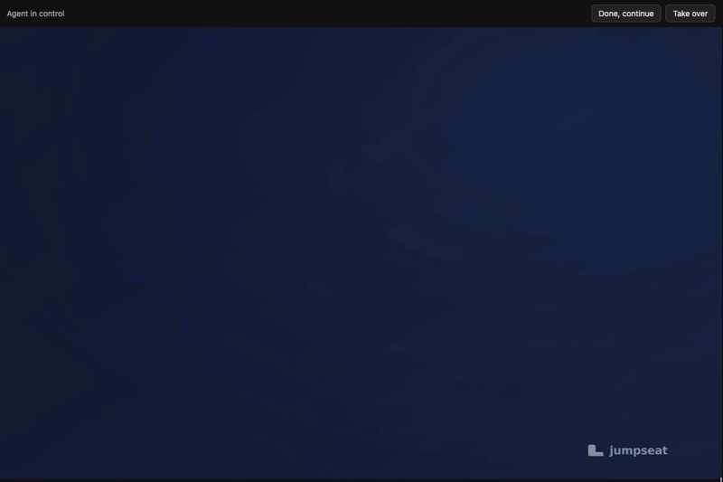

<h1 align="center">jumpseat</h1>
<p align="center">Watch a computer-use agent's desktop live, and take over when it needs you.</p>
<p align="center">
  <a href="#try-it">Try it</a> ·
  <a href="docs/reference.md">Reference</a> ·
  <a href="docs/operating.md">Operating</a> ·
  <a href="bench/README.md">Benchmarks</a>
</p>

jumpseat is one Go binary (plus libyuv, xclip and xdotool) that streams the Linux desktop your agent drives to
any browser, as H.264 over a single websocket. It runs at 60 fps, costs about
a third of a core while the screen moves and nothing while it is still, and
works through any HTTPS proxy or tunnel that forwards websockets: no WebRTC,
no TURN, no UDP.

It is built for an agent and a person sharing one desktop. The agent posts
captions of what it is doing, hands a step it cannot do (a sign-in, a
captcha) to the person, and checks whether the person is at the keyboard
before it clicks. The person sees "Your turn", takes over, and hands back.



*A real recording of the demo viewer in Chrome ([e2e/film.mjs](e2e/film.mjs)).
The "agent" is a script driving the desktop with xdotool and jumpseat's API;
the person's input goes through the viewer. The white dot is the person's
pointer, drawn for the recording.*

## How it compares

On one 4-vCPU sandbox (gVisor, no GPU) at 1280×800, against KasmVNC 1.5.0,
watched from a real browser across the network:

| | jumpseat | KasmVNC |
|---|---|---|
| frames per second, scrolling or animating | 60 | 24 |
| bandwidth, scrolling text | 0.66 Mbit/s | 14.8 Mbit/s |
| key → pixel, p50 | 30–40 ms | 48–73 ms |
| key → pixel while scrolling on a 1 Mbit/s link, p50 | 117–216 ms¹ | 1.1 s |
| CPU, X server and streamer, scrolling | ~0.3 cores | 0.38–0.48 |

¹ Measured with the x264 build, which needs twice the bits to scroll.

Its encoder is OpenH264's, changed for desktop content. On recorded desktop
frames it needs 40% fewer bits than x264 ultrafast to scroll, 26% fewer to
type and 10% fewer to animate, for fewer instructions a frame. The method,
the raw numbers and what did not help are in [bench/](bench/README.md).

## Try it

The demo image runs Xvfb, a window manager, Chromium and jumpseat:

```sh
docker build -f docker/Dockerfile -t jumpseat .
docker run --rm -p 8080:8080 -e JUMPSEAT_TOKEN=secret jumpseat
open "http://localhost:8080/?token=secret"
```

Then play the agent:

```sh
curl -H "Authorization: Bearer secret" -d '{"kind":"acting","text":"Opening the inbox"}' localhost:8080/agent/status
curl -H "Authorization: Bearer secret" -d '{"kind":"handoff","text":"Sign in to your email"}' localhost:8080/agent/status
curl -H "Authorization: Bearer secret" localhost:8080/agent/lease   # {"answer":"","driving":false,"lastInputMs":0}
```

To have the desktop follow the browser window (up to 2560×1600), run the
container with `-e JUMPSEAT_RESIZE=1` and open `/?token=secret&resize`.

## Use it

**On the machine with the desktop** (Xvfb or any X server):

```sh
jumpseat --listen :8080 --token "$TOKEN" --display :0
# or, behind your own proxy and auth:
jumpseat --listen unix:/run/jumpseat/stream.sock
```

**In your page**, with the client in [client/](client/jumpseat.ts) (no
dependencies):

```ts
import { connect, supportsStream } from "./jumpseat";

if (!(await supportsStream())) showFallback(); // no WebCodecs H.264 decoder
const view = connect(element, `wss://host/stream?token=${token}`, {
  connected: () => {},
  dropped: () => {},
  status: ({ kind, text }) => {}, // "acting" | "waiting" | "handoff" | "idle"
});
view.setControlling(true); // the person's keys, pointer and scrolls reach the desktop
```

**From your agent:**

- Before a step, `POST /agent/status {"kind":"acting","text":"Searching for flights"}`.
- After it, `GET /agent/wait` returns once the screen has settled, instead
  of a fixed sleep.
- For a step only a person can do, post `{"kind":"handoff","text":"Sign in to your email"}`,
  then poll `GET /agent/lease` until `answer` is `"done"`.
- Before clicking, check `GET /agent/lease`: while `driving` is true, the
  person is at the keyboard.
- `GET /agent/screenshot` returns the screen as a PNG.

Every flag, route, message and client option is in
[docs/reference.md](docs/reference.md). Deploying it safely is in
[docs/operating.md](docs/operating.md).

## How it works

XDamage says when the screen changed. The frame comes over MIT-SHM, libyuv
converts it, and the encoder in [h264/](h264/README.md) encodes it in
process. All viewers share that one capture and encoder; a viewer joining
restarts the encoder, so it starts on a keyframe. The browser decodes each frame with
WebCodecs as it arrives and acks it, and the server holds capture while
frames go unshown and caps the bitrate to what the link carries, so a slow
link drops frames instead of building up seconds of lag.

The person's input comes back on the same socket and goes into X through
XTest, with keys placed at the right keymap level so other keyboard layouts
type what they show. Trackpad scrolling arrives pixel by pixel on an Xvfb
with scroll axes on its XTest pointer, which the demo image builds; any
other X server gets wheel clicks.

The desktop streams at whatever size the X screen is, and starts over when
RandR changes it. With `--resize` the viewer asks for its window's size.
That is off by default, because an agent clicks at coordinates taken from
the size it last saw.

## Status

Early. The limits are listed in [docs/operating.md](docs/operating.md#limits).

Several pieces follow [voxl](https://github.com/tembo/voxl), a desktop
streamer for the browser with the same transport: `/agent/wait`, the shared
encoder, RandR resizing, and the Xvfb scroll patch, which is voxl's own.

## License

MIT for jumpseat. The encoder in `h264/` is BSD 2-clause (OpenH264). The Xvfb
patch in `docker/patches/` is voxl's, MIT ([its license](docker/patches/LICENSE-voxl)).
The optional `-tags x264` build links libx264, which is GPL. See
[LICENSE](LICENSE).
